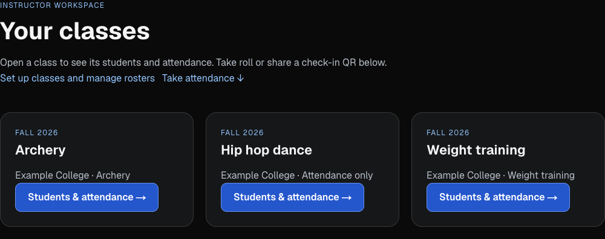
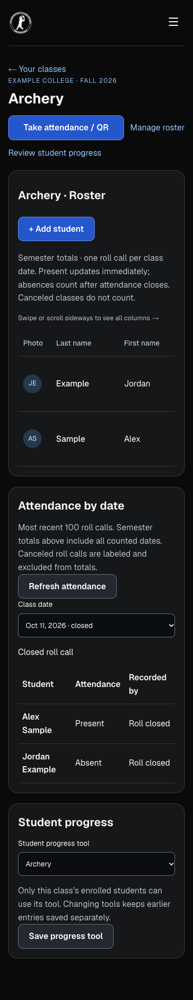
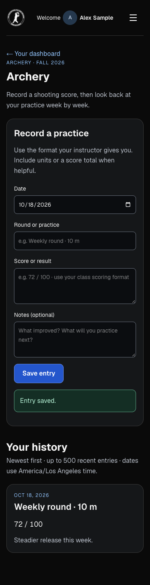

# Private class progress and teacher dashboard

Implemented locally on October 18, 2026. No production migration, deployment, roster edit, or live student entry was performed.

## What is ready

- `/attendance/instructor` starts with the instructor’s own class cards. Each opens `/attendance/instructor/classes/[classId]`, with the existing roster/semester attendance totals and dated roll-call records immediately available. The existing QR/roll console stays on its original URL below the cards. Class-specific links preselect its class.
- Teachers choose **Student progress tool → Archery / Weight training / Attendance only** on the class page or in Manage classes. New and existing classes default to Attendance only. No class is classified from its name.
- Enrolled students see an additional link on the corresponding card in `/dashboard`. Multiple enrollments expose their corresponding tools; dance-only accounts retain existing dance links and attendance. The Archery menu link is scoped to the class owner and currently eligible archery students; logged-out and unrelated accounts do not see it. Homepage and dance access logic are unchanged.
- `/attendance/progress/[classId]` provides a dated practice journal: round/practice or exercise/workout, a freeform score/performance result, and optional notes. The instructor can review the class entries there; students see only their own entries.

## Input and access decisions

The result field accepts text so the instructor can specify the scoring format, units, sets/reps, time or distance. There is no assumed archery scoring system, prescribed workout, numeric comparison or chart. Activity is limited to 160 characters, result to 1,000 and notes to 2,000. Students can backdate within their active enrollment and class dates, up to today in the class timezone.

The existing verified Google email and provider subject map to the actual class enrollment, including its dates and removal state. Every read/write checks this in PostgreSQL; hiding links is only presentation. Archived, out-of-term, dropped and removed students cannot access these tools. Instructors must own the class. A student-supplied enrollment ID, email or role never selects the record owner. Entries retain an enrollment and subject; switching tools hides other subjects’ entries without deleting them, and switching back restores their visibility.

The new table enables RLS and revokes all browser-role access. Only the server service role can invoke the new RPC, using the existing trusted identity and same-origin mutation checks. The function uses invoker privileges, with no SECURITY DEFINER. Requests and responses are private/no-store; existing attendance privacy headers and analytics exclusion cover the new pages. Entry IDs make exact save retries idempotent.

## Review screenshots

All screenshots use fictional classes and students in a disposable local database.



| Phone: class roster and attendance | Phone: archery journal |
| --- | --- |
|  |  |

[Workout journal](screenshots/class-progress/student-weights-mobile.png) · [Tablet journal](screenshots/class-progress/student-archery-tablet.png) · [Desktop journal](screenshots/class-progress/student-archery-desktop.png)

## Verification

- 73 attendance/progress/navigation checks passed. This includes the existing calendar, attendance transactions, QR checks, roster, privacy, sign-out and offline queue regressions.
- PostgreSQL integration tests cover class configuration, multiple subject discovery, own-record isolation, cross-class denial, instructor ownership, identity mismatch, email correction, enrollment expiry/removal, archived classes, subject separation, date/length validation, exact retries and browser-role denial. Read/configure/workspace/save are also exercised as the actual service role.
- Production build, TypeScript and targeted ESLint checks passed.
- Real browser → local Next.js production server → disposable PostgreSQL-compatible database flow passed for teacher dashboard, class roster, dated attendance, both student journals, hidden dance-only entry points, authorization errors, origin rejection, tool settings, instructor journal review and QR/roll opening/closing. Captured desktop (1920×1080), tablet (768×1024) and mobile (375×667); no page overflow or browser runtime errors.
- The existing Google OAuth exchange, live Supabase/PostgREST environment, and production deployment were not exercised.

Run the automated suite from the website folder:

```sh
rtk proxy sh -c 'node --import tsx --test --test-concurrency=2 tests/attendance-*.test.* tests/class-progress-*.test.* tests/my-classes-menu.test.mjs'
```

To reproduce the browser review, start `rtk proxy node tests/browser/class-progress-fixture.mjs` in a separate terminal. It creates fictional classes in memory on port 55434. Build/start Next.js on port 3105 using the following **local test-only** environment overrides (never use these test identity settings in a deployment):

```sh
rtk proxy env ATTENDANCE_ENABLED=true ATTENDANCE_SUPABASE_URL=http://127.0.0.1:55434 ATTENDANCE_SUPABASE_SERVICE_ROLE_KEY=local-fixture-only ATTENDANCE_INSTRUCTOR_EMAILS=teacher@example.com,other@example.com AUTH_SECRET=local-class-progress-fixture AUTH_URL=http://localhost:3105 AUTH_TRUST_HOST=true npm run build
rtk proxy env ATTENDANCE_ENABLED=true ATTENDANCE_SUPABASE_URL=http://127.0.0.1:55434 ATTENDANCE_SUPABASE_SERVICE_ROLE_KEY=local-fixture-only ATTENDANCE_INSTRUCTOR_EMAILS=teacher@example.com,other@example.com AUTH_SECRET=local-class-progress-fixture AUTH_URL=http://localhost:3105 AUTH_TRUST_HOST=true ./node_modules/.bin/next start -p 3105
```

Run `rtk proxy node tests/browser/class-progress-flow.mjs`. The browser script uses installed Playwright/Chrome or `BROWSER_NODE_MODULES` for a bundled package location. Restart the fixture before another run to reset fictional entries. Test login tokens are generated only by the test script, never by an application route.

## Remaining release action

For the full archery release, use the eight-migration sequence and production-based source described in [archery-modes.md](archery-modes.md#final-readiness-review--october-27-2026). The steps below describe the original journal-only dependency.

1. Review and apply **only** `supabase/migrations/20261018221205_attendance_class_progress.sql` to the database actually used by attendance (`ATTENDANCE_SUPABASE_URL` when configured; otherwise the main Supabase database). It depends on the existing attendance schema through `20260918030000_attendance_roster_removal.sql`. Confirm the target and current migration history before applying; unrelated pending migrations are outside this release.
2. Deploy the website code after the migration. The migration is additive and the older site ignores the new fields, so migration-first avoids a missing-function error on the new class pages. No new environment variables, domains, subdomains or DNS are needed.
3. As the real instructor, open existing classes and explicitly select Archery or Weight training. Hip hop/dance classes can remain Attendance only. Existing rosters determine access; this work does not invent or import assignments.
4. Verify with an enrolled test account and a non-enrolled account in the target environment. Existing QR and dance navigation should remain available.

## First-version limits

Journals are append-only from the UI; editing/deletion, charts, exports, pagination, standardized scoring, programming workouts and instructor comments are not included. A class journal shows the newest 500 entries; dated attendance shows the newest 100 roll calls, while existing semester totals still use all counted dates. Teachers can see preserved entries after enrollment ends; students’ tool access follows current enrollment and term dates. Journal saving requires a network connection; the existing offline attendance queue is unchanged.
